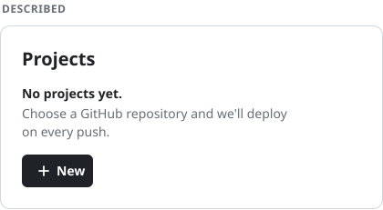
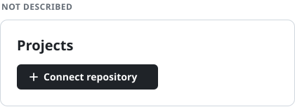
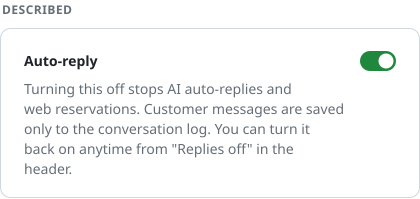
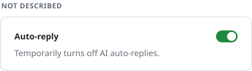
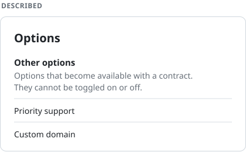
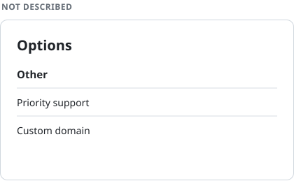
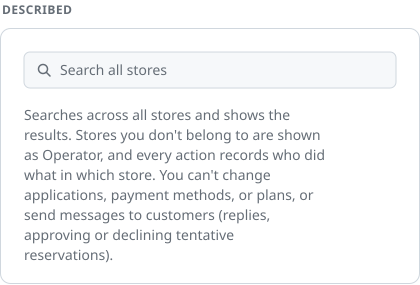
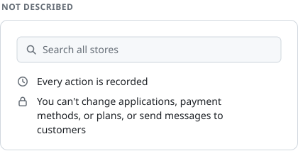

# stop-describe-ui

An agent skill that strips explanatory copy out of user interfaces.

```sh
npx skills add artouc/stop-describe-ui
```

## Before and after

<p>


</p>

<p>


</p>

<p>


</p>

<p>


</p>

See [skills/stop-describing-ui/SKILL.md](skills/stop-describing-ui/SKILL.md) for the rules.

## License

[MIT](LICENSE)
